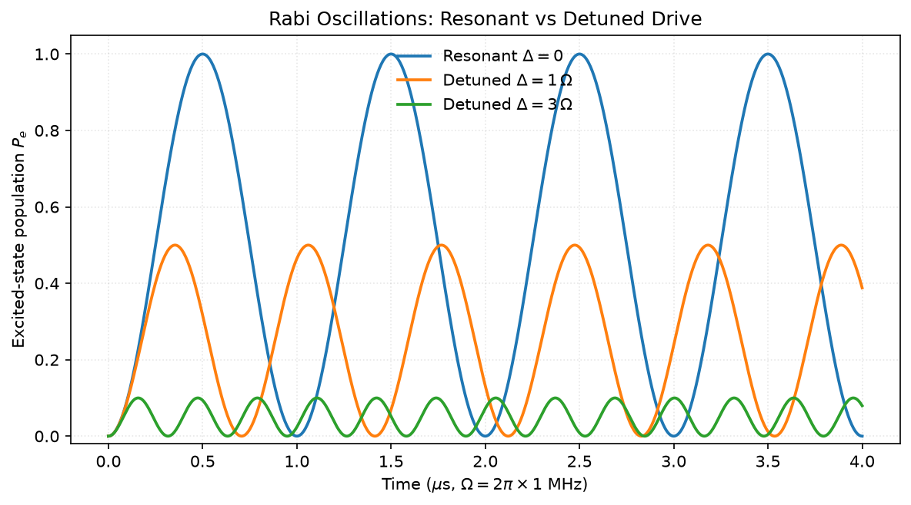
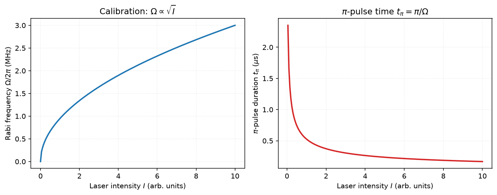
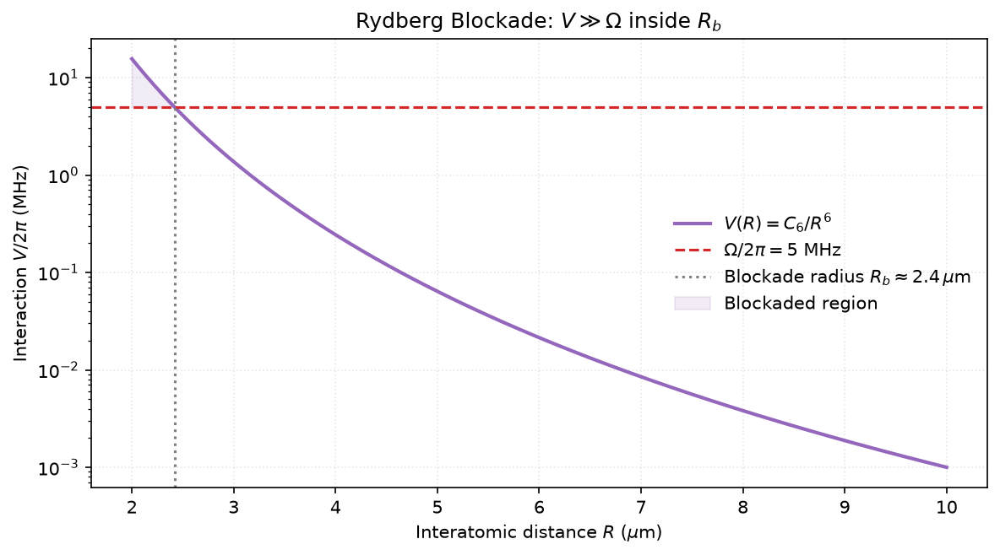
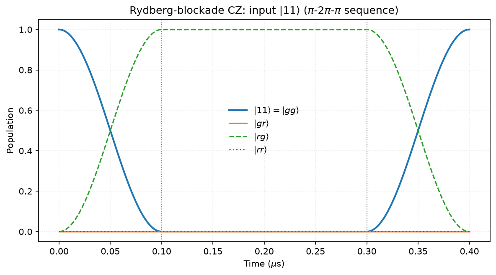
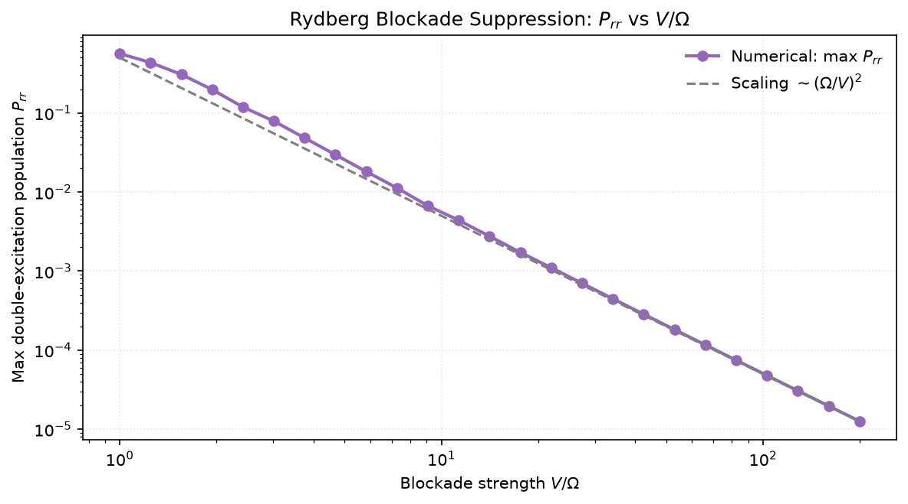
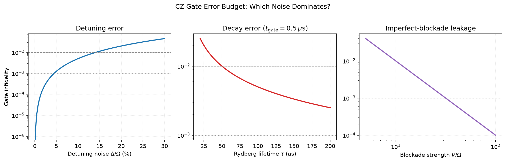

# 学习进度汇报（2026.08 – 2026.10） {#anchor-1}

**主题：精读 Dolev Bluvstein 博士论文 *Error-corrected quantum processing with neutral atoms* (2025)，边读边补基础、做数值模拟复现关键物理。**

**目前进度：论文主体已读完约 3/4** —— 平台、纠缠门、可重构阵列部分已完整读完并做了配套模拟；纠错实验部分读完逻辑比特编码与横向逻辑门，正在读深度电路执行章节。

## 目录

1. [论文第 1–2 章：中性原子平台与量子比特操控](#anchor-2)
2. [论文第 3 章：里德堡纠缠门](#anchor-3)
3. [论文第 4 章：可重构原子阵列架构](#anchor-4)
4. [论文第 5 章（前半）：逻辑量子比特与横向门](#anchor-5)
5. [代码成果总览](#anchor-6)
6. [下周计划](#anchor-7)
7. [附录：核心模拟代码](#anchor-8)

<!-- page-break -->

## 一、论文第 1–2 章：中性原子平台与量子比特操控 {#anchor-2}

**8 月上旬完成。**

**读的内容：**

- 中性原子量子计算总览：为什么中性原子平台适合规模化（天然全同、易扩展、可重构）
- ⁸⁷Rb 的能级结构：精细结构、超精细结构，用超精细基态钟态（clock states）编码量子比特，一阶磁场不敏感、相干时间达秒级
- 光镊俘获与 AC Stark 效应：偶极势正比于 $I/\Delta$
- 单比特操控：微波 / 拉曼双光子跃迁驱动 Rabi 振荡；失谐情形的广义 Rabi 频率 $\Omega_{\rm eff}=\sqrt{\Omega^2+\Delta^2}$，对比度下降为 $(\Omega/\Omega_{\rm eff})^2$

**补的基础：** 量子比特与 Bloch 球、Pauli 矩阵、张量积、单/双比特门语言；原子物理三件套（精细结构、超精细结构、Zeeman 效应）

**配套模拟：**





<!-- page-break -->

## 二、论文第 3 章：里德堡纠缠门 {#anchor-3}

**8 月下旬完成，本阶段的核心成果所在。**

**读的内容：**

- **里德堡阻塞**：相互作用 $V(R)=C_6/R^6$，$C_6\propto n^{11}$；阻塞条件 $V\gg\Omega$，阻塞半径 $R_b=(C_6/\Omega)^{1/6}$
- **CZ 门脉冲实现**：$\pi$–$2\pi$–$\pi$ 序列——控制比特先激发到里德堡态，目标比特的 $2\pi$ 转动被阻塞与否决定相位积累，净效果是 $\vert 11\rangle$ 获得 $\pi$ 相位
- **时间最优单脉冲门**与暗态选择（dark branch selection）：更短门时间、更高鲁棒性
- **门保真度现状**约 99.5%，误差来源：里德堡态衰减、激光失谐/强度噪声、阻塞不完全

**配套模拟（QuTiP）：**





QuTiP 双原子 CZ 模拟（$V/\Omega=40$）：$\vert 11\rangle$ 布居完整回归 1.0000，$\vert rr\rangle$ 泄漏峰值仅 $6\times10^{-4}$，验证阻塞图像。





<!-- page-break -->

## 三、论文第 4 章：可重构原子阵列架构 {#anchor-4}

**9 月完成。**

**读的内容：**

- SLM 生成静态任意几何阵列 + AOD 动态移动行列；装载随机性（约 50%）与重排（rearrangement）算法
- 分区架构：存储区 / 纠缠区 / 读出区分离，原子在区间穿梭完成电路
- 中途测量（mid-circuit measurement）与实时反馈（feedforward）：读出辅助比特而不干扰数据比特
- 核心认识：**可重构性 = 连接性不受近邻限制**，这是中性原子做纠错相对超导平台的根本优势

## 四、论文第 5 章（前半）：逻辑量子比特与横向门 {#anchor-5}

**9 月下旬 – 10 月初完成，目前在读深度电路执行章节。**

**读的内容：**

- QEC 框架：逻辑比特、稳定子测量、错误症候、码距 $d$ 与可纠正错误数 $t=\lfloor(d-1)/2\rfloor$
- 表面码 vs 色码：[[7,1,3]] Steane/色码的全部 Clifford 门可横向实现
- 横向门容错原理 + Eastin-Knill 定理的限制
- 论文标志性实验：百原子阵列上编码 48 个逻辑比特、用原子移动实现逻辑比特间横向纠缠门、逻辑线路保真度超越物理线路——"纠错的净收益"

<!-- page-break -->

## 五、代码成果总览 {#anchor-6}

| 代码文件 | 论文章节 | 物理内容 |
|---|---|---|
| `rabi_oscillations.py` | Ch.2 | 共振/失谐 Rabi 振荡 |
| `rabi_freq_vs_intensity.py` | Ch.2 | $\Omega\propto\sqrt{I}$ 标定与 $\pi$ 脉冲时长 |
| `blockade_potential.py` | Ch.3 | 阻塞势与阻塞半径 |
| `qutip_rydberg_cz.py` | Ch.3 | CZ 门三脉冲序列 QuTiP 全程模拟 |
| `blockade_suppression_scan.py` | Ch.3 | 阻塞抑制标度 $P_{rr}\sim(\Omega/V)^2$ 验证 |
| `fidelity_noise_scan.py` | Ch.3 | 门误差预算三类噪声对比 |

技术栈：Python 3 + NumPy / Matplotlib / QuTiP，全部运行验证通过。

## 六、下周计划（10.12 – 10.18） {#anchor-7}

1. **读完论文剩余部分**：深度电路执行章节（逻辑隐形传态、逐层纠错循环）+ 总结展望，整理"论文贡献一页纸"
2. **CZ 模拟升级**：从幺正演化（`sesolve`）升级到含耗散主方程（`mesolve`），加入里德堡自发辐射，定量输出"保真度 vs 衰减率"曲线并与解析误差预算对照
3. **复习巩固**：闪卡自测一轮（Rabi 动力学、阻塞机制、CZ 脉冲序列），整理论文第 3–5 章关键公式卡片

<!-- page-break -->

## 附录：核心模拟代码 {#anchor-8}

`qutip_rydberg_cz.py` — 里德堡阻塞 CZ 门 QuTiP 全程模拟：

```python
"""QuTiP simulation of a Rydberg-blockade CZ gate.

Protocol (Saffman-style pulse sequence):
  1. pi-pulse on the control atom   (|1> -> |r>)
  2. 2pi-pulse on the target atom   (blocked if control is in |r>)
  3. pi-pulse on the control atom   (|r> -> |1>)
Net effect: |11> acquires a pi phase -> CZ up to single-qubit phases.
"""

import numpy as np
import matplotlib.pyplot as plt
import qutip as qt

g = qt.basis(2, 0)
r = qt.basis(2, 1)
sm = g * r.dag()
I2 = qt.qeye(2)

def op_on_atom(op, atom):
    return qt.tensor(op, I2) if atom == 0 else qt.tensor(I2, op)

H1 = op_on_atom(sm + sm.dag(), 0)   # control drive
H2 = op_on_atom(sm + sm.dag(), 1)   # target drive
rr = qt.tensor(r, r)
H_int = rr * rr.dag()               # V |rr><rr|

Omega = 2 * np.pi * 5.0     # MHz * 2pi
V = 2 * np.pi * 200.0       # V >> Omega: blockade regime

t_pi = np.pi / Omega
t_2pi = 2 * np.pi / Omega
psi0 = qt.tensor(g, g)      # input |11>

pulses = [
    (0.5 * Omega * H1 + V * H_int, t_pi),
    (0.5 * Omega * H2 + V * H_int, t_2pi),
    (0.5 * Omega * H1 + V * H_int, t_pi),
]

times, states, t0 = [], [], 0.0
for H, dur in pulses:
    ts = np.linspace(0, dur, 200)
    res = qt.sesolve(H, psi0 if t0 == 0 else states[-1], ts)
    states.extend(res.states[1:] if t0 > 0 else res.states)
    times.extend((ts[1:] + t0) if t0 > 0 else ts)
    t0 += dur

# Result: final |11> population = 1.0000, max |rr> leakage = 6.2e-04
```

其余 5 个脚本（Rabi 振荡、强度标定、阻塞势、抑制标度、误差预算）结构类似，均为自包含可运行脚本。
